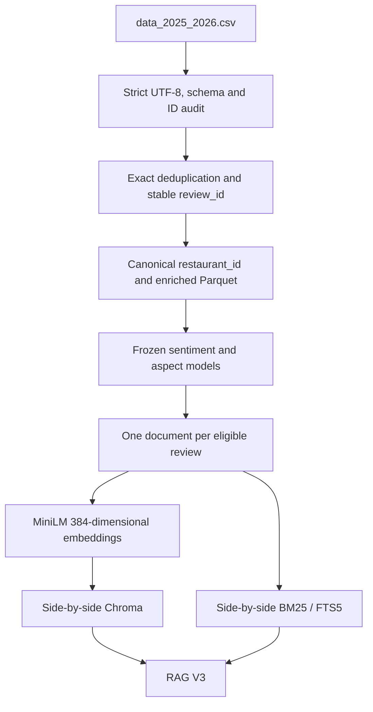
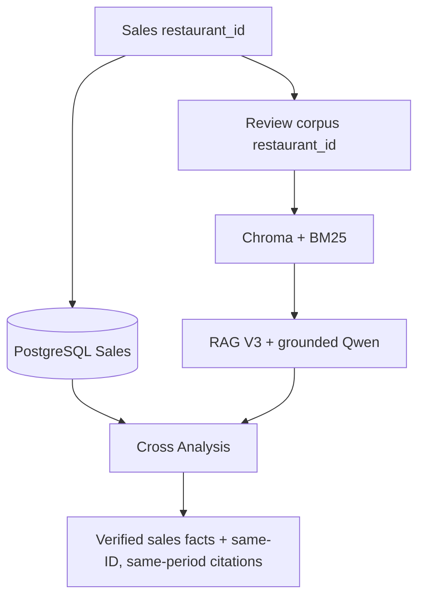

# Food Review Intelligence: direct-ID Sales and Review alignment

The 2025–2026 Review corpus and Sales warehouse share the same restaurant ID namespace. The acceptance audit found all **817** Review IDs in Sales and **817 exact name matches**. Names were diagnostic evidence; online joins use `restaurant_id` only. The prior name-derived Review corpus, indexes and mapping table remain for rollback.

## Review pipeline

The source has 15,639 rows; 183 exact duplicates are removed. All 15,456 distinct reviews are enriched with the existing models, without retraining or deriving sentiment from rating. Two comments contain U+FFFD; they remain in the auditable enriched corpus but are excluded from RAG. Both new indexes contain 15,454 stable review IDs. The existing one-document-per-review chunking policy remains.

The corpus covers **2025-01-01 through 2026-06-30**. Sales continues beyond this period. A Cross request for a later month returns SQL facts and explicitly states that same-period Review evidence is unavailable. It never substitutes older reviews.

## Identity and online query

The deterministic router selects Sales SQL, Review RAG or Cross Analysis. SQL uses predefined parameterized functions; Qwen never generates executable SQL. Cross verifies that the Sales ID exists in `dim_review_restaurant_v2`, then counts Review facts for the exact Sales month and passes the same `restaurant_id` and date bounds to dense and BM25 retrieval. Financial facts stay separate from Review observations, and the answer disclaims causation. Empty periods return a limitation without Review citations.

Review Intelligence selects `restaurant_id` internally and displays the restaurant name. The legacy `restaurant_key` applies only to the retained rollback corpus. Separate `dim_review_restaurant_v2` and `fact_review_v2` tables preserve the Sales and old Review facts. The v2 warehouse load is idempotent by source hash and review count.

Delivered `sales_amount` remains realized revenue. AOV uses Delivered revenue divided by Delivered orders; cancellation and refund rates use their respective counts divided by all orders. Existing warehouse business rules are unchanged.

## Operations and rollback

`config/review_corpus.yaml` selects the active corpus. The original Review source, Chroma/BM25 indexes and name mapping remain for rollback; model binaries are not duplicated. The active Review version and source checksum appear in `/version`, and demo-preflight checks the active index and manifest. SQLite LLMOps and Prometheus/Grafana metrics use the existing monitoring path. Restaurant IDs may appear in local request metadata, never in high-cardinality Prometheus labels.

The six-query known-positive benchmark is `reports/rag/review_2025_2026_known_relevance.json`. Its Hit@K/MRR values apply only to this new corpus and are not directly comparable with the old benchmark.
