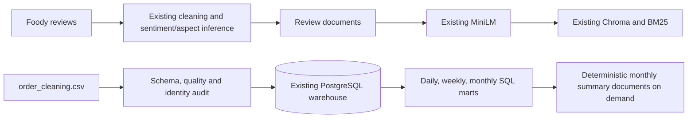
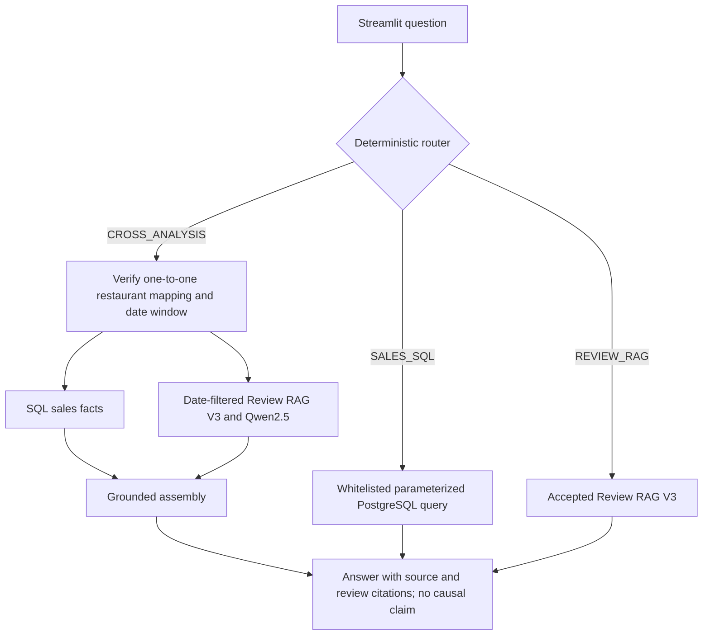
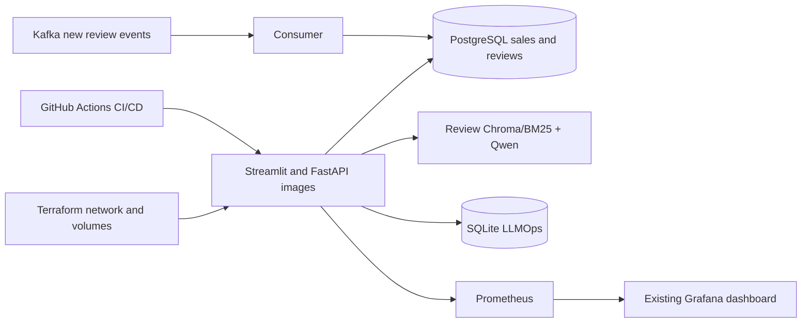

# Restaurant Intelligence: reviews and sales

The accepted Review-2 retrieval index and models remain frozen. The order CSV is a separate structured source. Restaurant IDs belong to the sales source; Foody reviews have name-derived keys, so cross-source joins use only audited, unique normalized-name matches. Unmatched or ambiguous identities cannot enter cross-analysis.

## Offline data

Monthly sales documents are generated from verified SQL aggregates on demand. There is no sales vector index: SQL answers exact numeric questions, and no online route needs semantic search over monthly numeric documents. This avoids an extra embedding/index build and keeps the 400,000 raw orders out of Chroma. `monthly_summary_document` uses fixed fields and metadata; its count is the number of available restaurant-month mart rows. The accepted review Chroma/BM25 is not altered.

## Online query

The cross route computes revenue and growth with SQL, then asks the accepted RAG V3 a review complaint question for the **same restaurant and sales month**. Qwen only summarizes retrieved review evidence through the existing V3 support gate. The final assembly keeps SQL numbers separate from review observations and explicitly says that temporal coincidence does not establish causation. If the mapping, sales month, or aligned reviews are absent, it returns a limitation rather than mixing unrelated evidence. Review-only questions retain the existing path.

Delivered `sales_amount` is realized revenue. Gross sales includes all statuses and is never presented as realized revenue. AOV is Delivered revenue divided by Delivered order count. Cancellation/refund rates use order counts divided by all order counts. Sales dated after the current Vietnam date remain in `fact_order` for audit but are excluded from observed marts. A completed month is the default comparison period; a requested current month uses the same elapsed day range of the previous month.

## Operations

Historical orders are batch loaded with `python -m src.cli sales-load`; they are not replayed through Kafka. The loader uses source SHA256, a transaction, a unique `order_id`, and upserts. A review warehouse reload preserves the shared dimensions used by sales. Prometheus labels are bounded statuses only, with no question or restaurant names.
