# Final local demo architecture

The presentation demo runs on the existing Foody and VN-MSASar artifacts. It does not crawl, train, enrich, or index at startup. `config/demo.yaml` pins the active model paths, RAG V3 prompt, top-k, vector collection, retrieval policy, and SQLite log path. `python -m src.cli demo-preflight` checks them before launch.

```mermaid
flowchart LR
    A[Foody source CSV<br/>33,946 rows] --> B[Cleaning and validation]
    B --> C[AI enrichment<br/>TF-IDF sentiment + aspect OVR + issue rules]
    C --> D[Restaurant marts<br/>summary, time, aspect, issue, alerts]
    C --> E[32,457 review documents]
    E --> F[Chroma MiniLM vectors]
    E --> G[SQLite FTS5 BM25]
    F --> H[RAG V3 routed retrieval]
    G --> H
    D --> H
    H --> I[Intent and evidence gates]
    I --> J[Evidence packet]
    J --> K[Qwen2.5 3B Q4_K_M]
    K --> L[Clause-level citation validation]
    L --> M{Supported?}
    M -- Yes --> N[Cited synthesis]
    M -- No --> O[Cited extractive fallback]
    I -- No compatible evidence --> P[Insufficient evidence]
    N --> Q[Streamlit four-page demo]
    O --> Q
    P --> Q
    Q --> R[SQLite LLMOps operational events]
```

The Foody source is a real review export. Cleaning preserves source rows and separate validity flags. The research sentiment model is text-only TF-IDF plus logistic regression trained on a leakage-controlled VN-MSASar split. The aspect model is a separate TF-IDF OneVsRest classifier. Foody has no trusted gold sentiment or aspect labels, so its predictions are **inference**, not measured Foody accuracy. Issue extraction is heuristic and gated by the predictions. Marts aggregate the enriched reviews for restaurant counts, ratings, trends, aspect/issue distribution, and historical rule alerts.

Review documents share the same 32,457 review IDs in Chroma and BM25. The active embedding model is `sentence-transformers/paraphrase-multilingual-MiniLM-L12-v2` using local CPU/ONNX. V3 routes aspect-specific complaints to filtered BM25 with evidence reranking, general questions to RRF hybrid, and causal questions to a mart guard. The evidence gate rejects incompatible polarity/topic evidence; a negative service complaint cannot rely only on positive service praise. Qwen2.5-3B-Instruct-GGUF Q4_K_M then phrases accepted evidence. The clause validator checks each factual clause against its cited review. Failed generation gets a cited extractive fallback; no compatible evidence gets an explicit insufficient-evidence answer. Neither fallback nor refusal is hidden.

Model versions and checksums are recorded in `reports/foody_intelligence/versions.json`, Chroma/BM25 manifests, and Qwen provenance JSON. Prompt versions are hashed and the active V3 version is pinned in `config/demo.yaml`. VN-MSASar research runs and selected model metrics are tracked through the existing MLflow artifacts; V3 operational events go to `state/llmops.sqlite` without raw user query or review text. Raw rejected V3 generations are retained only in the intentional evaluation artifact `reports/rag_v3/generator_comparison.json`.

The four Streamlit pages show restaurant intelligence, source/AI review fields, a cited RAG answer with mode, and separated research versus demo monitoring. The Windows launcher runs read-only preflight, starts the pinned local llama.cpp server if needed, and runs Streamlit. `docker compose config` passed previously; Docker runtime remains **NOT VERIFIED** because the daemon was unavailable. Existing CI/test workflows are local syntax/unit checks; they do not establish live Docker or cloud runtime acceptance. Phase 1 Databricks processing is outside this demo path.

The complete measured V3 result and limits are in `reports/rag_v3/RAG_V3_ACCEPTANCE_REPORT.md`. The six-query known-positive retrieval set is incomplete and too small for a general reliability claim.
