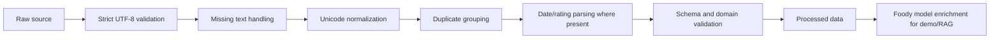

# Cleaning and labeling flow

VN-MSASar labels are supplied by the public dataset. Review-ID and normalized-text groups define the frozen split, without removing the 5,869 sentence/aspect rows. Foody is a first-party crawl; its AI cleaning verifies text/date/rating fields and creates deduplicated observations. Sentiment/aspect enrichment is model inference, not manual gold labeling. No human annotation or inter-annotator Kappa is claimed.
