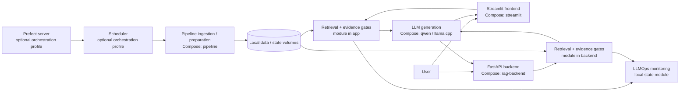

# Actual Docker/service architecture

The architecture below reflects `docker-compose.yml`, `Dockerfile.rag`, `app/app.py`, and `app/api.py`. Boxes marked **module** run inside an application container; they are not independent services.

`pipeline` handles ingestion and preparation. The optional `prefect-server` and `scheduler` services orchestrate jobs. `streamlit` is the frontend; `rag-backend` is a separate FastAPI container. Both have retrieval code in their images and the same mounted data, model, report, and state paths; the verified RAG V3 request ran through Streamlit. `qwen` is a llama.cpp server with the accepted Qwen2.5 3B GGUF mounted read-only. Monitoring writes local state; there is no separate monitoring container. These are actual Compose boundaries, not a claim of production microservice deployment.

| Logical component | Actual deployment boundary | Runtime evidence |
| --- | --- | --- |
| Data / ingestion | `pipeline` Compose service; optional Prefect server and scheduler | Rebuilt pipeline image imports `psutil` and `src.cli`; default CLI-help startup exited (0). No ingestion was run. Optional orchestration profile not started. |
| Retrieval / vector access | Python module inside Streamlit and API images; shared local mounts | No separate retrieval container. Chroma/BM25 counts 32,457 verified in containers; Streamlit RAG V3 query succeeded. |
| LLM generation | `qwen` llama.cpp Compose service | Independently running and healthy on 8193, loaded Qwen2.5 3B; CPU inference completed. |
| API | `rag-backend` FastAPI Compose service | Independently running; `/health` HTTP 200. V3 API query not claimed; `/ask` is an older RAG path. |
| Frontend | `streamlit` Compose service | Independently running; HTTP health 200 and Analyst handler returned a cited V3 result without warning. |
| Monitoring | LLMOps module writing mounted local SQLite state | No separate monitoring container; new content-free V3 events 400 and 403 verified. |

Local Docker acceptance verifies the **three required serving containers** (Qwen, API, Streamlit) are independently running; Qwen has a passing container health check, while API and Streamlit have passing HTTP health endpoints. The retrieval and monitoring modules are not independent services. The historical pipeline's default one-shot CLI-help command now exits successfully (0), as detailed in `DOCKER_ACCEPTANCE.md`.

The Compose default now points to the accepted Qwen2.5 3B file; `QWEN_MODEL_FILE` allows an explicit 1.5B override. The GGUF stays outside the image on a read-only runtime mount. See `DOCKER_ACCEPTANCE.md` for the exact file, health, request, and GPU evidence.
