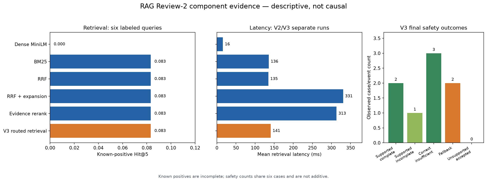

# Final RAG component comparison

This report reconstructs the **observed progression** from saved fixed-evaluation artifacts; it does not rerun RAG or claim a controlled component-off experiment. The companion `RAG_ABLATION_FINAL.csv` keeps retrieval and generation/safety metrics in separate rows.

## A. Retrieval ablation

| Variant | Known-positive Hit@5 | Hit@10 | MRR | Mean retrieval ms | p95 ms |
| --- | ---: | ---: | ---: | ---: | ---: |
| Dense MiniLM (V1) | 0.000000 | 0.083333 | 0.018519 | 15.761 | 18.319 |
| BM25 (V2) | 0.083333 | 0.083333 | 0.166667 | 135.941 | 188.462 |
| RRF (V2) | 0.083333 | 0.083333 | 0.041667 | 134.744 | 182.258 |
| RRF + expansion (V2) | 0.083333 | 0.083333 | 0.055556 | 330.792 | 419.119 |
| Evidence rerank (V2) | 0.083333 | 0.083333 | 0.055556 | 313.404 | 398.832 |
| V3 routed retrieval | 0.083333 | 0.083333 | 0.166667 | 140.970 | 195.149 |

Dense, BM25, RRF, expansion, and rerank are from `../rag_v2/retrieval_candidates.csv`; routed retrieval is from `../rag_v3/retrieval_policies.csv`. BM25-derived policies find one additional known positive in the top five compared with Dense MiniLM. RRF, expansion, and rerank do not add a Hit@5/Hit@10 gain in this set; expansion and rerank cost more latency in the V2 run. Routed retrieval selects the policy by intent and matches BM25's measured MRR here. The six-question relevance annotations contain **incomplete known positives**, so these are not full recall estimates. V2 and V3 latency measurements come from separate runs and are not paired speed comparisons.

## B. Generation and safety ablation

All outcome counts below refer to the same **six fixed V3 examples** and the accepted Qwen 3B replay. N/A means the metric does not apply to that stage; it is not a measured zero. Component rows are observed traces, not counterfactual runs with a component disabled.

| Stage | Accepted evidence packets | Rejected unsupported attempts | Supported complete | Supported incomplete | Unsupported accepted | Correct insufficient | Fallbacks |
| --- | ---: | ---: | ---: | ---: | ---: | ---: | ---: |
| Evidence compatibility | 3 | N/A | N/A | N/A | N/A | N/A | N/A |
| Clause-level validation | N/A | 5 | N/A | N/A | N/A | N/A | N/A |
| Insufficient-evidence guard | N/A | N/A | N/A | N/A | N/A | 3 | N/A |
| Extractive fallback | N/A | N/A | 1 | 1 | 0 | N/A | 2 |
| Final V3 system | 3 | 5 | 2 | 1 | 0 | 3 | 2 |

**Evidence compatibility:** `../rag_v3/evidence_packets.json` records three accepted packets and three `INSUFFICIENT_EVIDENCE` packets. A retrieved review praising prices cannot support a *price complaint*; positive service evidence cannot support a *service complaint*. This check limits the evidence eligible for an answer.

**Clause-level validation:** `../rag_v3/generation_failure_analysis.json` records five rejected Qwen 3B attempts, all categorized `unsupported_clause`, including a recorded “Answer clause lacks cited support” failure. Its earlier 1.5B diagnostic separately records the concrete failure of combining details from different reviews while attaching insufficient citation support. The validator checks each factual clause against its own cited review; a citation to one review cannot justify an unrelated second fact. The five 3B rejections are attempt counts and may repeat a question, not five distinct final answers.

**Insufficient-evidence guard:** the `price`, `rating_drop`, and `empty_period` cases were correctly refused without a generation call. This prevents a price complaint from being inferred from price praise or a causal rating-drop claim from sparse reviews. These are three case outcomes, not retrieval Hit@k.

**Extractive fallback:** the `complaints` and `food` cases retained cited evidence after Qwen generation failed validation. The final complaint answer is supported but incomplete because one review cannot establish the *most common* complaint; the food answer is supported complete. In the saved V2 food example, useful food reviews were retrieved but the final answer said insufficient evidence after an answer-topic mismatch. The V3 fallback preserves a useful cited snippet rather than discarding that evidence. The 3B service case supplied the other supported complete final answer without fallback.

The final counts (2 supported complete, 1 supported incomplete, 0 validator-detected unsupported accepted, 3 correct insufficient, 2 fallbacks) come from `../rag_v3/generation_metrics.json`. The observed event chain makes each component's role visible, meeting the Review-2 **evidence-synthesis** checklist criterion. It does **not** estimate the individual causal improvement from removing each safety component; there is no packet-off, validator-off, guard-off, or fallback-off control. Six cases and automated validation also do not establish a population hallucination rate. Retrieval Hit@k is N/A for every generation/safety row.
